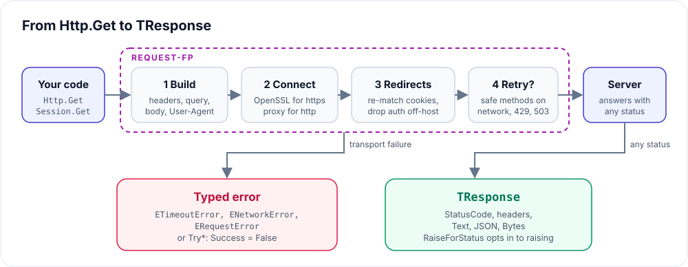
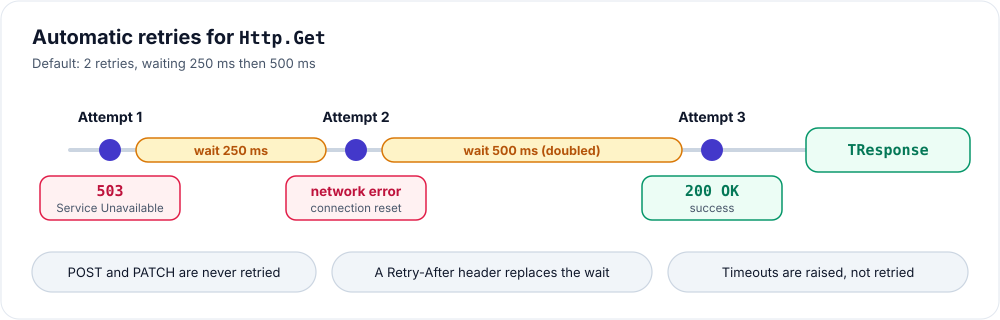
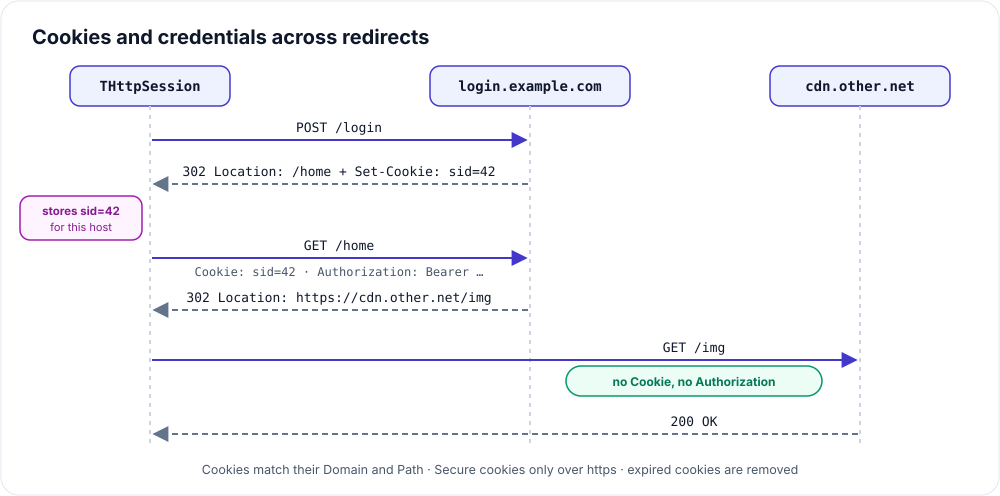
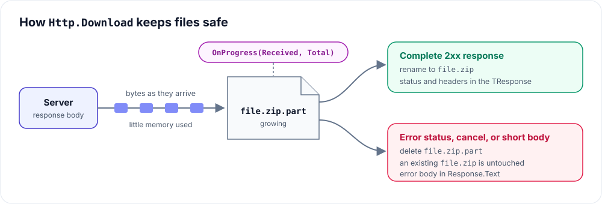

# How it works

What happens between `Http.Get` and the `TResponse` you get back.

## A request, end to end



1. **Build.** Headers, query parameters, and the body are prepared. A
   `User-Agent` is added unless you set one.
2. **Connect.** `https://` URLs load OpenSSL on first use. `http://` URLs go
   through a proxy when one is set.
3. **Follow redirects.** Cookies are re-matched for each new URL, and
   `Authorization` is dropped if the redirect leaves the host.
4. **Retry if it is safe.** See below.
5. **Return.** Any HTTP status becomes a `TResponse`. A transport failure
   raises `ETimeoutError`, `ENetworkError`, or `ERequestError`, or fills
   `TRequestResult` for `Try*` methods.

Records with management operators free everything automatically: there is
no client object to free, and `Response.JSON` is owned by the response.

## Retries



- Only GET, HEAD, PUT, and DELETE are retried. These are safe to repeat;
  POST and PATCH could create or change something twice.
- Retried: network errors, `429 Too Many Requests`, `503 Service
  Unavailable`. Not retried: timeouts, other statuses.
- Waits double each time: 250 ms, then 500 ms by default.
- `Retry-After` replaces the wait. If it is longer than the timeout, the
  response is returned straight away so your code can decide.
- A download is not retried once bytes have been written.

Change it with `Http.SetRetry(Count, FirstDelayMS)`; `SetRetry(0, 0)` turns
it off.

## Cookies and redirects in a session



- `Set-Cookie` headers on redirect responses are kept, so a login that
  answers with a redirect still logs you in.
- Each cookie remembers its `Domain` and `Path` and is only sent where they
  match. `Secure` cookies go over HTTPS only. Expired cookies are removed.
- When a redirect moves to another host, the session's own cookies and the
  `Authorization` header stay behind.

## Streaming downloads



- The body is written as it arrives, so a 4 GB file needs little memory.
- Bytes go to `file.part`. Only a complete 2xx response renames it to the
  real name, so an existing file is never half-overwritten.
- Error statuses leave the file alone and put the error body in
  `Response.Text`.
- A body shorter than `Content-Length` raises `ENetworkError`; FPC alone
  would accept it silently.
- Raising an exception in the progress callback cancels the download.

Uploads work the same way in reverse: `PostMultipart` reads each file from
disk while sending.

## Errors

```text
Exception
└── ERequestError        any Request-FP failure
    └── ENetworkError    connection, DNS, socket, TLS, server closed early
        └── ETimeoutError connect timeout or I/O timeout
```

Catch the most specific class first. HTTP error statuses are not exceptions
unless you call `Response.RaiseForStatus`.

See [Technical details](TECHNICAL-DETAILS.md) for FPC and OpenSSL internals.
