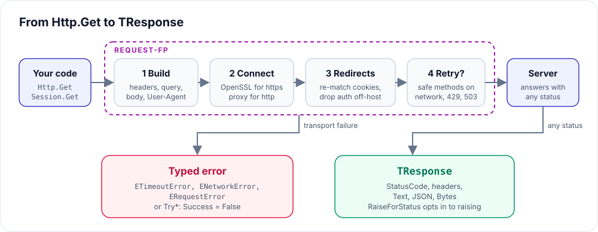

# Request-FP

An easy, memory-safe HTTP client for Free Pascal. One line per request, no
objects to free, and sensible behaviour when the network is not.

```pascal
uses Request;

var
  Response: TResponse;
begin
  Response := Http.Get('https://api.example.com/users');
  Response.RaiseForStatus;
  WriteLn(Response.JSON.FindPath('[0].name').AsString);
end.
```

There is no client to create and nothing to free: `TResponse` cleans itself
up, including its parsed JSON.

## What you get

| Need | Request-FP |
| --- | --- |
| Quick calls | `Http.Get`, `Post`, `PostJSON`, `PutJSON`, `PatchJSON`, `Delete`, `Head` |
| Forms and files | `PostForm`, `PostMultipart` (files streamed from disk) |
| Large downloads | `Http.Download(URL, FilePath, @ShowProgress)` |
| Shared state | `THttpSession`: base URL, headers, cookies, auth |
| Flaky networks | Automatic retries for safe methods, `Retry-After`, timeouts |
| Clear failures | `ETimeoutError`, `ENetworkError`, `ERequestError`, or `Try*` results |
| HTTPS | OpenSSL 3 found automatically on Windows, Linux, and macOS |



## Pick your path

- **New here?** [Getting started](getting-started.md) takes you from install
  to a working session in a few minutes.
- **Need a reminder?** The [cheat sheet](cheat-sheet.md) fits on one screen.
- **One-off calls:** [Stateless requests](Request.md) covers every `Http`
  method, downloads, retries, and the error policy.
- **Logins and APIs:** [Sessions](Request.Session.md) keep cookies, headers,
  and credentials between calls.
- **Curious about the internals?** [How it works](how-it-works.md) explains
  retries, redirects, cookies, and streaming with diagrams.
- **HTTPS trouble?** Start with the [SSL/HTTPS setup](SSL-HTTPS-GUIDE.md).

## Requirements

- Free Pascal 3.2.2+ or Lazarus 4.8+
- Windows, Linux, or macOS
- OpenSSL 3 (or 1.1) for HTTPS only
